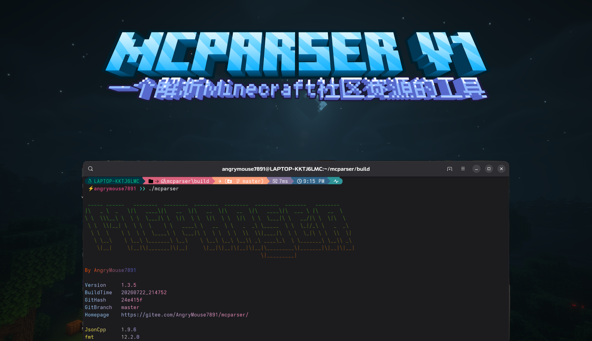
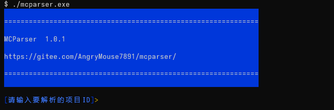
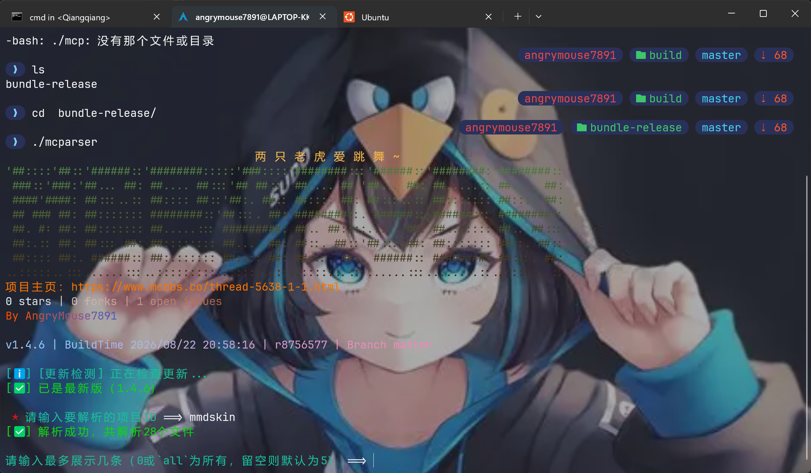
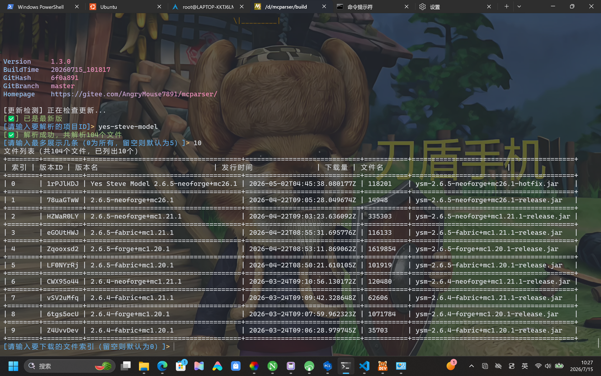
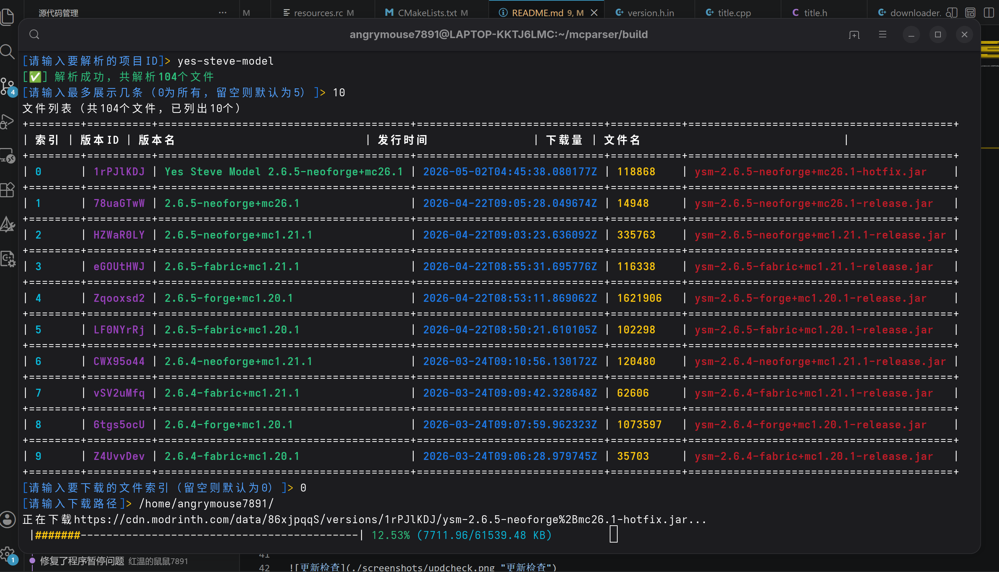
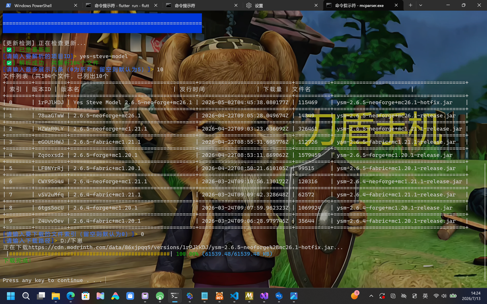
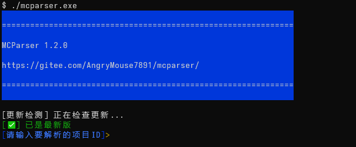

 
    

 

# 
 MCParser   
 

   
   
   
   
   
   
   

---

## 公告栏

### 2026/08/22

> [!WARNING]
> 由于Gitee Releases附件大小限额已达1G，v1.4.5及之后的版本的预构建二进制文件已不再在Gitee Releases上提交。请大家选择其他下载线路以下载最新版本。
> 虽然以后仍会创建发行版，但只会上传源码了…… :cry:  

> [!TIP]
> 由于2026年8月20日本人已注册蓝奏云盘账号，新版本已开始上传至蓝奏云盘，速度更快！
> 分享链接（提取码`cu7m`）：<https://wwbdd.lanzouu.com/b01euppgqj>

## 简介

MCParser是一个一个一个一个~~一个一个一个一个一个一个一个一个一个~~解析《我的世界》社区资源（如模组）的工具，使用C++语言编写，部分由AI赋能。

## 特性

* ✅ 完全使用C++编写
* ✅ 性能极强
* ✅ 支持彩色输出
* ✅ 跨平台

## 截图

启动屏幕

解析成功

文件列表

下载文件

下载完成

更新检查

## 下载链接

Gitee Releases（预构建二进制文件仅`<=1.4.4`版本可下载）：<https://gitee.com/AngryMouse7891/mcparser/releases>

夸克网盘：<https://pan.quark.cn/s/f88f5aed5752>

百度网盘（提取码`bikb`）：<https://pan.baidu.com/s/1-WTiixGq7kUxkVbkALO_Ew>

蓝奏云（可下载Windows、Linux版，提取码`cu7m`）：<https://wwbdd.lanzouu.com/b01euppgqj>

MineBBS：<https://www.minebbs.com/resources/mcparser.17435/>

MCBBS纪念版：<https://www.mcbbs.co/thread-5638-1-1.html>

BBSMC：<https://bbsmc.net/software/mcparser>

## 支持的资源平台

| 资源平台 | 是否支持 |
| ----- | ----- |
| [Curseforge](https://curseforge.com "Curseforge官网") | ❌ |
| [Modrinth](https://modrinth.com "Modrinth官网") | ✅ |
| [MCArchive](https://mcarchive.net "MCArchive官网") | ❌ |

## 使用库

JsonCpp（JSON解析）：<https://github.com/open-source-parsers/jsoncpp>

libcurl（文件下载+API接口调用）：<https://curl.se/>

fmt（字符串格式化+部分文字输出）：<https://github.com/fmtlib/fmt>

termcolor（彩色终端输出）：<https://github.com/ikalnytskyi/termcolor>

Tabulate（终端表格库）：<https://github.com/p-ranav/tabulate>
